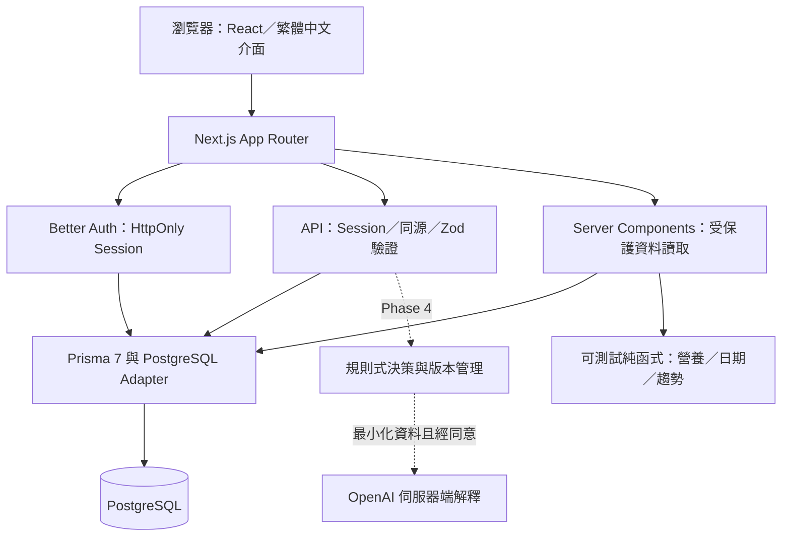
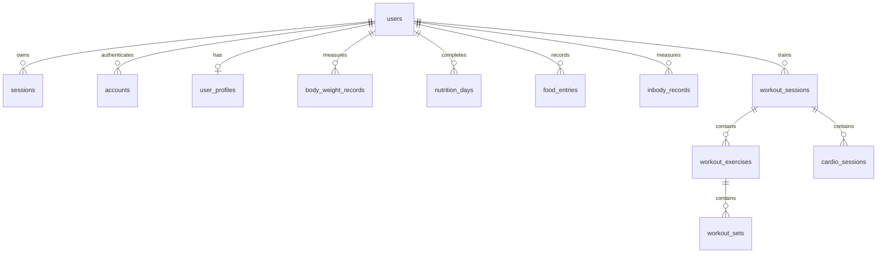

# 需求分析與系統架構

## Phase 1 邊界

本次交付對應 Master Prompt 最後指令：「專案架構設計與 Phase 1 實作」。先完成真實帳號、真實個人資料與 Dashboard，後續功能保留明確模組邊界。沒有外部憑證時提供本機資料庫模式；不虛構正式資料庫或 OpenAI 金鑰。

主要使用者是管理飲食、訓練與身體組成的一般成年人；目標是支持可持續追蹤，不能把短期波動當作成果或自動產生缺乏依據的調整。

## 系統結構

Next.js 使用 Node.js Runtime，與標準 PostgreSQL TCP 連線。前端只呼叫自己的 API，Prisma／登入密鑰以 `server-only` 隔離。所有健康資料請求用 Session 的 `user.id` 篩選；前端傳入的 `userId` 不具授權效力。

本機以 PGlite 執行真實 PostgreSQL 引擎並透過 socket 連接相同 Prisma adapter。它是開發／測試替代，不等同標準 PostgreSQL 的並行、備份或營運能力。正式部署採 Node.js + PostgreSQL；本階段是本機原始碼交付，沒有使用 Sites 的 Worker 託管替代需求指定的伺服器架構。

## 程式模組

| 位置 | 責任 |
| --- | --- |
| `src/app/(auth)` | 登入／註冊入口 |
| `src/app/(app)` | Session 保護的總覽、設定、後續模組狀態 |
| `src/app/api/auth` | Better Auth handler |
| `src/app/api/profile` | Session 身分下的個人檔案讀寫 |
| `src/app/api/dashboard` | 同一套 Dashboard 真實資料查詢 |
| `src/lib/auth*`／`session.ts` | 認證與 Session |
| `src/lib/db.ts`／`env.ts` | 單例資料庫連線與秘密設定 |
| `src/lib/api.ts` | API 授權、同源、串流大小與錯誤處理 |
| `src/lib/profile-schema.ts` | 共用輸入與型別定義 |
| `src/lib/nutrition.ts`／`dates.ts` | 無外部依賴的核心計算 |
| `src/lib/dashboard.ts` | 依使用者與台北日期彙整資料 |
| `src/components/ui` | 可持續擴充的 shadcn/ui 風格基礎元件 |
| `prisma/migrations` | 已提交 PostgreSQL SQL Migration |
| `tests`／`scripts/test-e2e.ts` | 純函式、真實資料庫及 HTTP E2E |

## 已建立模型

`prisma/schema.prisma` 是本版唯一執行模型來源；以下均已產生 SQL Migration。

- `users`：Better Auth 主帳號；Email 唯一。
- `sessions`、`accounts`、`verifications`、`rate_limits`：登入、密碼帳號、驗證與共用限流儲存。
- `user_profiles`：`userId` 唯一，包含暱稱、年齡、公式性別、身高、基準體重、目標、活動、可訓練時間、偏好、過敏、適用情況及手動目標。
- `body_weight_records`：體重、測量時間、腰圍、睡眠、疲勞；依 `[userId, measuredAt]` 索引。
- `food_entries`：時間、餐次、食物、份量、營養素、來源與備註；`nutrition_days` 獨立標記完整日。
- `inbody_records`：主要身體組成、儀器及測量條件備註。
- `workout_sessions` → `workout_exercises` → `workout_sets`：每次訓練、動作與逐組表現；`cardio_sessions` 保存有氧紀錄。

健康紀錄的模型已就緒；Phase 1 尚未對外開放紀錄 CRUD。所有與帳號直接關聯的健康表皆有 `onDelete: Cascade`；子動作／組數同樣級聯。健康紀錄以有時區的時間儲存，完整日使用 `DATE`。登入驗證資料維持 Better Auth 相容欄位。

## 尚未建立的後續正規化模型

以下是設計規劃，**不是已建立資料表**。新增時需提交新 Migration 與擁有權／刪除測試。

| 模型 | 關聯與主要欄位 | 階段 |
| --- | --- | --- |
| `foods` | `userId`、名稱、每 100g 營養、來源、常用標記；公開食物與私有食物分權 | 2 |
| `recipes`、`recipe_items` | 使用者食譜與食物組成、份量 | 5 |
| `nutrition_plans` | `userId`、名稱、目前版本指標 | 3 |
| `nutrition_plan_versions` | `planId`、版本號、熱量／營養素、建立原因、生效日、不可變快照 | 3 |
| `nutrition_plan_meals` | `versionId`、餐次、分配、訓練／休息日類型 | 3 |
| `workout_plans` | `userId`、分化方式、目前版本指標 | 3 |
| `workout_plan_versions` | `planId`、版本號、原因、生效日 | 3 |
| `workout_plan_days`、`workout_plan_exercises` | 版本下的天數、動作、組次、強度與休息安排 | 3 |
| `weekly_reports` | `userId`、台北週起日、資料截止點、規則版本、有效樣本統計 | 4 |
| `monthly_reports` | `userId`、月份、同類統計快照與跨月比較 | 4 |
| `ai_recommendations` | `userId`、報告、依據、可信度、提案、狀態、原計畫版本 | 4 |
| `recommendation_approvals` | `userId`、提案、接受／拒絕、時間、新版本 ID；防止重複接受 | 4 |
| `ai_processing_consents` | `userId`、告知版本、同意與撤回時間 | 4 |

關聯需在伺服器端同時檢查擁有者，避免用他人的 foodId／planId／sessionId 越權；僅有外鍵存在並不等同資料授權。版本表採 `[planId, version]` 唯一鍵，報告採 `[userId, periodStart]` 唯一鍵。接受建議需在單一交易中驗證原版本、建立新版本、更新指標、寫入審核紀錄；拒絕不得更改既有計畫。

## 頁面與流程

- `/login`、`/register`：Email／密碼，註冊密碼至少 12 字元。註冊成功進個人設定。
- `/`：今日營養／剩餘熱量、個人目標、最近體重／7 日平均、訓練次數／時間、完整日數、InBody 快照、後續教練規劃。資料缺漏以 `—` 呈現。
- `/settings`：基本資料、體態目標、訓練偏好、飲食限制、手動目標、計算預覽、資料處理說明與刪除帳號。
- `/modules/{food,weight,inbody,workouts,nutrition-plan,workout-plan,coach,reports}`：明確標記尚未實作及所屬 Phase，不提供假按鈕或假儲存。
- 窄螢幕底部快速導覽與側邊抽屜，桌面固定側欄；使用 next-themes 保留顯示偏好。

## 後續優先順序

1. Phase 2：逐一完成飲食 → 體重 → InBody → 訓練 CRUD；每個新增／修改／刪除都驗證 Dashboard 更新與跨帳號拒絕。先補齊欄位與資料庫 Check Constraints，再開放寫入 API。
2. Phase 3：先做不可變計畫版本，再依有效紀錄天數做週／月比較；缺漏紀錄不可當零。
3. Phase 4：先建立可測試的規則引擎及同意流程，再接 OpenAI；至少 14 天代表性資料、完整度、實際與計畫差距、蛋白質、恢復／訓練交叉檢核。模型只能解讀已算好的事實，不產生或覆寫數據。
4. Phase 5：辨識結果必須經使用者確認；離線佇列要解決重複提交、時區與衝突，健康資料不可無限制留存在共享裝置。

## 技術風險與已知限制

- 公式與活動係數是起點；不具個人代謝校正能力，尚未依趨勢自動調整。
- 資料來源與量測條件必須在 Phase 2 開放寫入前驗證；單次 InBody 波動不能解讀為成果。
- Better Auth 目前有安全雜湊、Session 與限流，但正式 Email 驗證／找回密碼寄送服務未配置。
- 初版沒有多因素驗證、正式稽核、備份還原與壓力測試；PGlite 通過測試不能取代正式 PostgreSQL 部署驗證。
- 開發環境的本機 PGlite 無密碼驗證；只綁定 loopback，禁止使用於公開伺服器。
- UI 的計算預覽不會自動儲存；必須明確點儲存設定，避免覆寫使用者意願。
- Phase 1 修改個人設定尚不構成版本化飲食／訓練計畫；計畫版本能力要在 Phase 3 建立，不宣稱已具備。

實作對照官方文件：[Next.js 安裝與 App Router](https://nextjs.org/docs/app/getting-started/installation)、[Better Auth Prisma adapter](https://better-auth.com/docs/adapters/prisma)、[Prisma 7 驅動與設定](https://www.prisma.io/docs/orm/v7)、[PGlite socket 開發模式](https://pglite.dev/docs/pglite-socket)。
